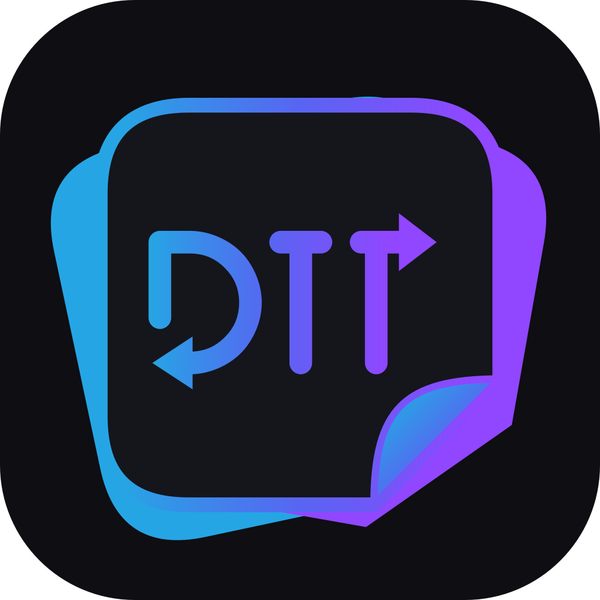
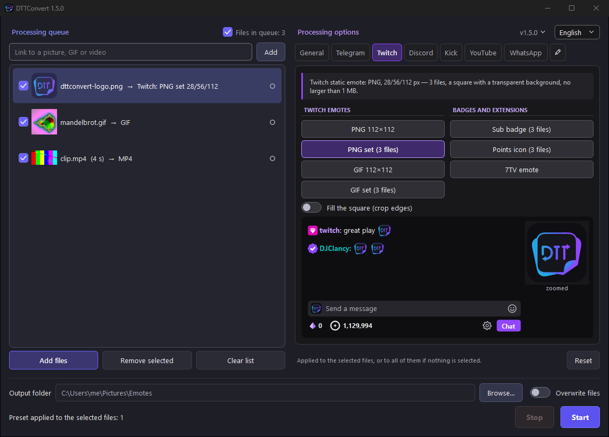

<p align="center">
  
</p>

<h1 align="center">DTTConvert</h1>

<p align="center">
  <a href="https://github.com/Hxrmfull/DTTConvert/releases/latest"></a>
  <a href="https://github.com/Hxrmfull/DTTConvert/releases"></a>
  
  <a href="LICENSE"></a>
</p>

<p align="center"><a href="README.md">English</a> · <b>Русский</b></p>

Конвертер картинок, GIF, видео и стикеров для **D**iscord, **T**elegram и
**T**witch, а также WhatsApp, Kick, YouTube и 7TV. Пресеты сами подбирают размер,
частоту кадров и вес, чтобы площадка приняла файл с первой попытки.

Интерфейс на русском и английском, язык переключается в правом верхнем углу.



## Скачать

Windows 10/11, 64 бита — страница [релизов](../../releases).

| Файл | Что это |
|---|---|
| `…-with-ffmpeg-setup.exe` | Установщик с FFmpeg — проще всего, прав администратора не нужно |
| `…-without-ffmpeg-setup.exe` | Установщик без FFmpeg — если FFmpeg уже есть |
| `…-with-ffmpeg.zip` | Без установки, с FFmpeg: распаковать и запустить |
| `…-without-ffmpeg.zip` | Без установки и без FFmpeg — самый лёгкий |

Из архива программа запускается сразу; переносить нужно **всю папку**
(рядом с exe лежит `_internal`).

**SmartScreen** («Система Windows защитила ваш компьютер»): программа
без цифровой подписи. Нажмите «Подробнее» → «Выполнить в любом случае».

**Без FFmpeg** работают только картинки (JPG, PNG, WEBP, BMP, AVIF).
Для видео, GIF, стикеров и звука положите `ffmpeg.exe` и `ffprobe.exe`
рядом с `DTTConvert.exe` или установите FFmpeg в `PATH`
([сборки для Windows](https://www.gyan.dev/ffmpeg/builds/)).

## Что умеет

- **На входе:** JPG, PNG, APNG, WEBP, BMP, AVIF, HEIC, TIFF, GIF, видео
  (MP4, WebM, AVI, MOV, MKV и др.) и анимированные стикеры Telegram `.tgs`.
  Анимированные WEBP, AVIF и APNG узнаются по содержимому.
- **На выходе:** JPG, PNG, WEBP, BMP, AVIF, GIF, APNG, MP4, WebM, AVI,
  звук (MP3, M4A, WAV) и покадровый разбор в PNG.
- **Пресеты площадок** — см. таблицу ниже. Предпросмотр показывает
  результат прямо в макете чата Telegram, Twitch, Discord, WhatsApp, Kick
  и YouTube.
- **Правка:** размер, частота кадров, обрезка по времени, поворот,
  отражение, качество, ограничение веса файла, звук оставить или убрать.
  «Заполнить квадрат» обрезает края вместо прозрачных полей.
- **Очередь:** перетаскивание файлов и папок, вставка из буфера (`Ctrl+V`),
  свои настройки у каждого файла, параллельная обработка, отчёт в CSV.
  Исходник никогда не перезаписывается.
- **Ссылки:** вставьте ссылку `Ctrl+V`, перетащите её из браузера или
  выберите «Добавить по ссылке…» в меню очереди. Подходит прямая ссылка
  на файл, страница 7TV, FFZ, Giphy и любая страница с картинкой.
- **Вкладки:** карандаш справа от вкладок позволяет перетащить их в
  удобном порядке.
- **Клавиши:** `Ctrl+O` — добавить, `Delete` — убрать, `Alt+↑/↓` — порядок,
  `Ctrl+Enter` — старт, `Esc` — стоп. Всё окно проходится через `Tab`.

## Требования площадок

| Площадка | Пресет | Формат и лимиты |
|---|---|---|
| Telegram | Стикер | PNG/WEBP, сторона 512 px; видео — WEBM/VP9, ≤ 3 с, ≤ 30 FPS, ≤ 256 КБ, без звука |
| Telegram | Эмодзи | PNG/WEBP 100×100; видео — WEBM, те же лимиты |
| Discord | Стикер | PNG или APNG 320×320, ≤ 512 КБ, анимация ≤ 5 с |
| Discord | Эмодзи | PNG или GIF 128×128, ≤ 256 КБ |
| Twitch | Смайлик | PNG/GIF 112×112 или комплект 28/56/112, ≤ 1 МБ, GIF ≤ 60 кадров |
| Twitch | Значок подписки, баллы | PNG, комплекты 18/36/72 и 28/56/112, каждый ≤ 25 КБ |
| 7TV | Смайлик | WEBP или PNG, высота 128 px, свои пропорции до 3:1, ≤ 7 МБ |
| WhatsApp | Стикер | WEBP 512×512, ≤ 100 КБ; анимация ≤ 10 с, ≤ 500 КБ; иконка набора PNG 96×96 |
| Kick | Смайлик, значок подписки | PNG 500×500 или GIF 256×256, < 1 МБ; значок PNG комплектом 36/72 |
| YouTube | Эмодзи и значок спонсора | PNG 480×480 и 128×128, < 1 МБ (анимацию YouTube не показывает) |

Стикер `.tgs` переводится в любой из этих форматов, в GIF и видео; обратно
в `.tgs` перевести нельзя — это векторный формат.

## Запуск из исходников

Python 3.9+:

```bash
pip install -r requirements.txt
python src/main.py
```

`pillow-heif` нужен только для HEIC, `rlottie-python` — только для `.tgs`.
Код лежит в `src/`, значок — в `assets/`.

Сборка для Windows (нужен [PyInstaller](https://pyinstaller.org/); для
установщиков — [Inno Setup 6](https://jrsoftware.org/isdl.php)):

```powershell
powershell -File build_windows.ps1              # архивы с FFmpeg и без в release\
powershell -File build_windows.ps1 -Installer   # плюс установщики
```

Ключи: `-Variant with-ffmpeg|without-ffmpeg`, `-FfmpegDir <папка>`, `-NoZip`.
Вшиваемый FFmpeg сверяется с `ffmpeg_checksums.txt`.

## Прочее

- **Меню версии** (номер версии в правом верхнем углу): проверка обновлений,
  цвета площадок на вкладках, анимация файлов, папка журнала (`%LOCALAPPDATA%\DTTConvert\logs\app.log`).
- **Анимация:** короткие анимации и видео (до 10 сек) проигрываются в
  миниатюрах очереди и в предпросмотре; длинные видео стоят одним кадром.
  Отключается в меню версии.
- **Обновления:** при каждом запуске программа спрашивает GitHub о новой
  версии и показывает ссылку вместо номера версии. В установленной программе
  щелчок скачивает установщик, проверяет его и обновляет программу; копия
  из архива открывает страницу выпуска. Проверка отключается в меню версии.
- **История изменений** — в [CHANGELOG.ru.md](CHANGELOG.ru.md).

## Лицензии

Код — [MIT](LICENSE). FFmpeg во вшитой сборке — LGPL/GPL, его лицензия
лежит рядом с exe (`FFmpeg-LICENSE`). Стикеры `.tgs` рисует
[rlottie-python](https://github.com/laggykiller/rlottie-python) (LGPL 2.1):
его `rlottie.dll` — отдельный заменяемый файл в `_internal\rlottie_python`,
лицензия — `rlottie-python-LICENSE.txt` рядом с exe.
